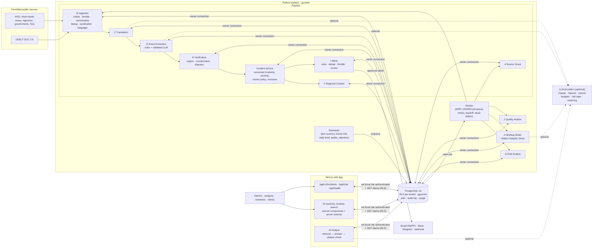

# Architecture

Three moving parts share one PostgreSQL database: a Next.js web app, a Python worker that processes a
job queue, and a scheduler that enqueues recurring work. There is no separate queue service or cache;
Postgres row-level security (RLS) is the tenant boundary for everything the web app reads or writes.

## Components

| Component | Code | Runs as |
| --- | --- | --- |
| Web app | `apps/web` (Next.js 16 App Router, TypeScript, Tailwind 4, MapLibre 6) | `node server.js` (standalone build), stateless, horizontally scalable |
| Worker | `workers/gccintel/worker.py` + agents | `gccintel worker`; any number of replicas (jobs are claimed with `FOR UPDATE SKIP LOCKED`) |
| Scheduler | `workers/gccintel/scheduler.py` | `gccintel scheduler`; one instance (enqueues are idempotent through dedupe keys, so a brief overlap during a restart is harmless) |
| Database | `db/migrations/*.sql` | PostgreSQL 16 with `vector` and `citext`; Supabase-compatible (`auth.uid()`, `auth.jwt()`, `anon` / `authenticated` / `service_role`) |
| Demo feed server | `workers/gccintel/demo_server.py` | `gccintel demo-feeds`, demo mode only, serves SYNTHETIC RSS in two stages |

## The pipeline, step by step

| Specification step | Where |
| --- | --- |
| 1. Schedule retrieval by source and importance | `scheduler.py` enqueues `run_pipeline` when a source is due (`next_fetch_at`, per-source interval and priority, backoff after failures) |
| 2. Normalise and validate | `adapters/rss.py`, `text/normalize.py`; source time zones applied to naive feed dates |
| 3. Canonicalise URLs, remove exact duplicates | `text/urls.py` (tracking parameters stripped, nothing else), unique `(tenant, canonical_url)` and content hash |
| 4. Cluster near-duplicate reporting | `text/simhash.py` (SimHash + shingle Jaccard); event matching in `agents/incidents.py` (category, place hierarchy, distance, time window) |
| 5. Detect language, translate | `text/lang.py` (Arabic, English; Persian, Hebrew, Turkish, French detected), `agents/translation.py` (LLM only, original always kept) |
| 6. Extract entities, type, time, place, actors, claims, casualties, sectors | `agents/extraction.py`, `text/gazetteer.py`, `text/taxonomy.py` |
| 7. Original vs syndicated vs copied | `agents/ingestion.py` (syndication parent, wire markers), origin keys in `agents/incidents.py` |
| 8. Evidence and provenance | `articles`, `claims`, `claim_provenance`, `incident_articles` (role, origin key) |
| 9. Corroboration and confidence | `agents/verification.py` (pure function, unit-tested) |
| 10. Versioned incident | `agents/incidents.py` (`incident_revisions` with snapshot, changed fields, who/which agent) |
| 11. Risk and alert triggers | `agents/alerts.py` on every incident change; `agents/risk.py` hourly |
| 12. Briefs from verified structured records | `agents/briefing.py`; integrity check before saving, publication guard in the database |

## Agents A–J

Each agent is a module with a narrow job. Agents do not converse with each other or change policy;
the orchestration is ordinary code. Model calls go through one `LLMService` that enforces per-run call
caps, a daily cap and the organisation's monthly budget, timeouts and retries, and meters every call
(`llm_usage`). The web app's AI analyst applies the same daily and monthly limits.

| Agent | Module | Deterministic core | Optional model use (validated) |
| --- | --- | --- | --- |
| A Source Scout | `agents/source_scout.py` | Proposes catalogue sources; checks robots.txt, reachability, parsing, time zone. Never approves or enables a source | None |
| B Ingestion | `agents/ingestion.py` | Fetch, normalise, dedup, syndication, language, injection flags, permitted excerpts, source health | None |
| C Translation | `agents/translation.py` | Keeps originals; labels untranslated text | Translation, with model name recorded |
| D Event Extraction | `agents/extraction.py` | Keyword taxonomy (EN/AR), gazetteer places, stated casualties, stance, attributions | Summary and recall; categories must exist, places resolve through the gazetteer, numbers and attributions must appear in the source text |
| E Verification | `agents/verification.py` | Origins, independence, statuses, disputes, retractions | None |
| F Regional Context | `agents/context.py` | GCC exposure pathways, related incidents, watch indicators | None |
| G Risk Analyst | `agents/risk.py` | Versioned methodology, factor contributions | None |
| H Briefing Writer | `agents/briefing.py` | Template writer from stored incidents; citation integrity check | Executive summary and assessment rewrite, accepted only if every paragraph cites valid evidence and adds no numbers |
| I Alerts | `agents/alerts.py` | Matching, impact, review routing, dedup, throttling, follow-ups, delivery with retries | None |
| J Quality Auditor | `agents/quality.py` | Unsupported incidents, low-confidence placements, possible duplicates, failing citation checks, failing sources, stale queues, spend, injection flags, sampled broken links | None |

Severity, verification status, review requirements and alert impact are never taken from a model, so
a prompt injection in an article cannot escalate an incident or trigger a high-impact alert.

## Multi-tenancy and access control

- Every tenant table carries `tenant_id` and has RLS policies (`db/migrations/0006_rls.sql`).
- The web app connects as the schema owner but runs each request's queries inside a transaction that
  sets `request.jwt.claims` (user, active tenant) and `set local role authenticated`
  (`apps/web/src/lib/db.ts: withRls`). Policies check membership and role through `SECURITY DEFINER`
  helpers (`app.has_role`, `app.is_staff`, ...), so a forged tenant claim without membership sees nothing.
- A few privileged operations use the owner connection explicitly: sign-in, user creation, MFA
  secrets, password changes, test-mode plan changes, and LLM budget accounting.
- Workers are trusted system processes: they connect as the owner and filter by tenant explicitly;
  job handlers check that every object in a payload belongs to the job's tenant.
- Roles: **admin** (everything, including sources, members, policies), **analyst** (edit incidents,
  sources, reports; queue jobs), **reviewer** (approve incidents and alerts, publish reports),
  **client** (read published output, manage own alert rules and watchlists).

## Data model (main tables)

| Group | Tables |
| --- | --- |
| Tenancy and SaaS | `tenants`, `app_users`, `memberships`, `plans`, `watchlists`, `tenant_secrets`, `tenant_counters`, `rate_limits` |
| Sources | `sources`, `source_health`, `source_catalog` |
| Evidence | `articles`, `claims`, `claim_provenance`, `incident_candidates` |
| Incidents | `incidents`, `incident_articles`, `incident_revisions`, `event_types`, `geo_entities`, `actors` |
| Analysis | `risk_methodologies`, `risk_assessments`, `reports`, `report_versions`, `report_exports` |
| Alerting | `alert_rules`, `alerts`, `alert_deliveries` |
| Workflow and governance | `analyst_reviews`, `audit_log`, `jobs`, `llm_usage`, `chat_sessions`, `chat_messages`, `schema_migrations` |

Retention rules (`0007_retention.sql`, run daily) clear stored article excerpts after 365 days, chat
history after 365 days and audit entries after 730 days (each configurable per organisation in
`tenants.settings.retention`), and trim source-health rows (90 days), finished jobs (30 days), report
exports (90 days, regenerable) and LLM usage rows (400 days). Incidents, revisions, reports and report
versions are kept.

## Observability

- Structured JSON logs from the workers (`LOG_JSON=true`), one line per event with tenant, job and
  source identifiers; secrets are never logged.
- `source_health` for every fetch, `jobs` with attempts and errors, `llm_usage` per agent and model,
  `alert_deliveries` per channel attempt, `audit_log` for every human decision. The Administration and
  Sources pages show them.
- `GET /api/health` reports database reachability, applied migrations and queue depth.

## Why these choices

- **Postgres job queue instead of Redis/BullMQ**: one fewer stateful service; `SKIP LOCKED` gives
  safe concurrency and the jobs table doubles as an audit of background work. The queue interface is
  small (`workers/gccintel/queue.py`) and can be swapped.
- **Full-text retrieval for the AI analyst**: deterministic, explainable and good enough for the
  structured incident store; pgvector is installed for semantic retrieval later (roadmap).
- **Python for the pipeline, TypeScript for the app**: the shared formats (scrypt hashes, AES-GCM
  ciphertexts with tenant-bound AAD, TOTP) are tested from both sides.
